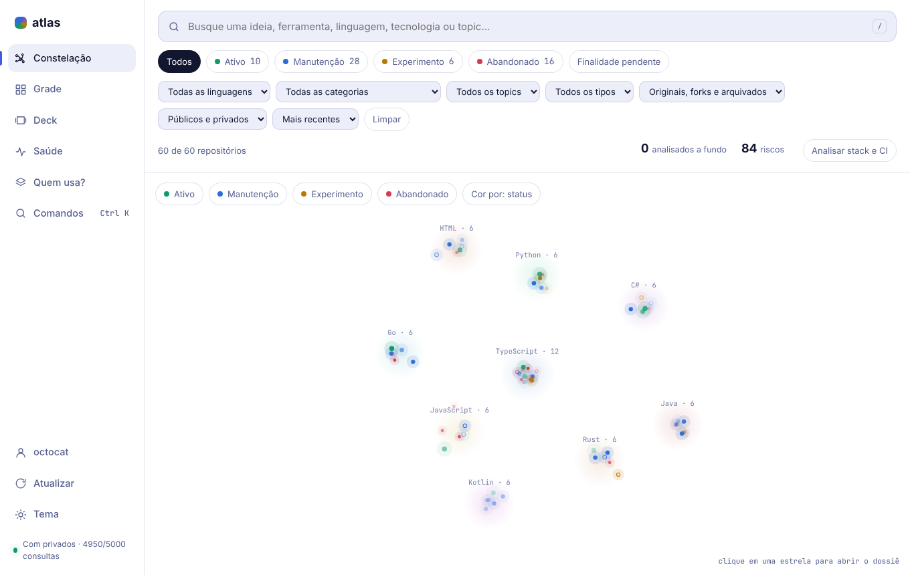
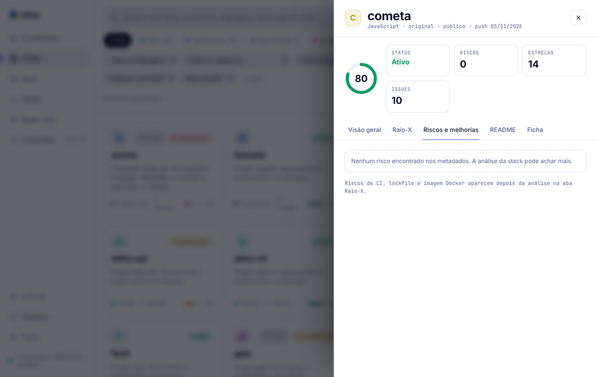
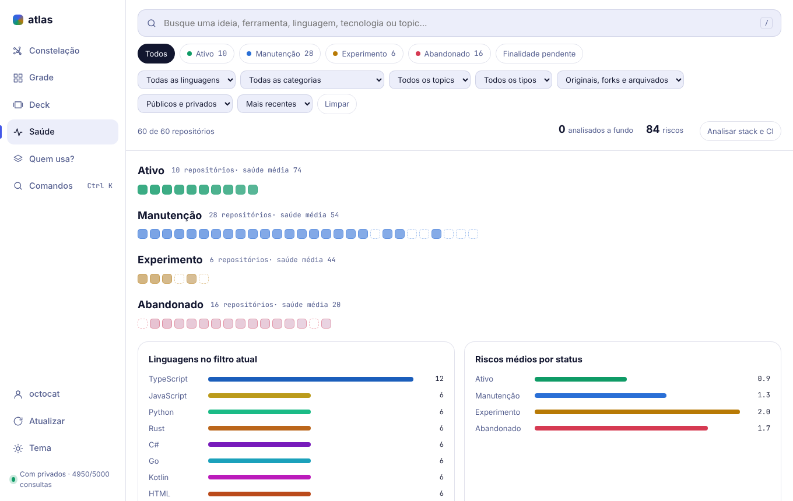
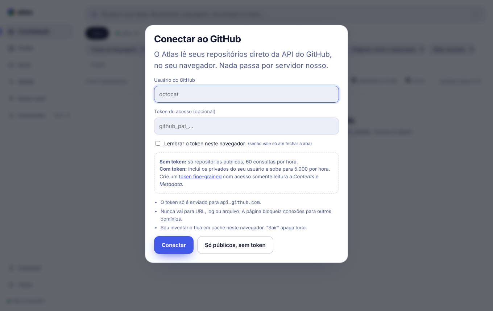
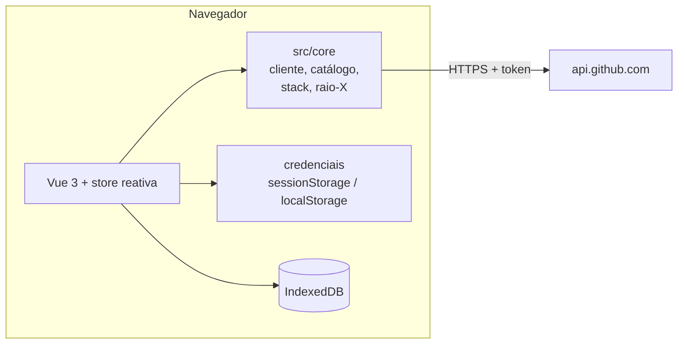

# Atlas

Veja tudo o que você construiu no GitHub, com um raio-X de cada repositório.

O Atlas lê os repositórios de qualquer conta direto da API do GitHub, no navegador, e mostra status, pontuação de saúde, riscos com a correção sugerida e a stack de cada projeto. Não tem servidor, banco de dados nem usuário fixo no código. Cada pessoa informa o próprio usuário e, se quiser ver os privados, um token de leitura.

Feito em **TypeScript** (modo `strict`), Vue 3 e Vite. Publicado como site estático no GitHub Pages.



## Sumário

- [Recursos](#recursos)
- [Começando](#começando)
- [Como o raio-X é calculado](#como-o-raio-x-é-calculado)
- [Privacidade e segurança](#privacidade-e-segurança)
- [Cota da API do GitHub](#cota-da-api-do-github)
- [Arquitetura](#arquitetura)
- [Desenvolvimento](#desenvolvimento)
- [Testes](#testes)
- [Publicar no GitHub Pages](#publicar-no-github-pages)
- [CLI e servidor MCP](#cli-e-servidor-mcp)

## Recursos

| Visão | Para quê |
|---|---|
| **Constelação** | Um ponto por repositório, agrupado por linguagem. Cor por status ou por linguagem. Clique para abrir o raio-X. |
| **Grade** | Cards com busca e filtros por status, linguagem, categoria, topic, tipo de projeto, origem (original, fork, arquivado) e visibilidade. |
| **Deck** | Um repositório por vez, com o README renderizado ao lado. Navegue com as setas ou deslizando. |
| **Saúde** | Mosaico por status, uma célula por repositório, com a pontuação de saúde e gráficos por linguagem e risco. |
| **Quem usa?** | Quais repositórios usam uma dependência, quais têm mais riscos e quais estão sem CI. Depois da análise a fundo, mostra também as **divergências** entre repositórios: versões de Node, gerenciadores de pacotes, imagens base do Docker e versões de workflows reutilizáveis. |

Também inclui:

- **Painel do repositório** com visão geral, raio-X, riscos e melhorias, README e ficha pessoal.
- **Ficha pessoal**: escreva a finalidade e escolha categorias. Fica só no seu navegador e não altera nada no GitHub.
- **Remover do catálogo** com desfazer, para esconder o que você não quer ver.
- **Exportar** o filtro atual em planilha (CSV), dados (JSON), relatório (Markdown) ou **plano de topics**, no mesmo formato da CLI. Salve em `.catalog/topics-plan.json`, revise e rode `pnpm topics:apply`. O CSV neutraliza células que começam com `=`, `+`, `-` ou `@`.
- **Links por visão**: a URL guarda a visão (`#constelacao`, `#grade`, `#deck`, `#saude`, `#stack`), então dá para marcar ou compartilhar.
- **Paleta de comandos** (`Ctrl K`), atalho `/` para a busca e `←` `→` no Deck.
- **Tema claro e escuro**, que segue o sistema.
- **PWA**: o shell do app funciona offline.

<p>
  
  
</p>

## Começando

1. Abra o site e informe seu **usuário do GitHub**.
2. (Opcional) Cole um **token** para incluir os repositórios privados e aumentar a cota.
3. Clique em **Conectar**.



| | Sem token | Com token |
|---|---|---|
| Repositórios | Só os públicos | Públicos e privados do seu usuário |
| Cota da API | 60 consultas por hora | 5.000 por hora |
| Análise da stack e do CI | Repositório a repositório | Todos de uma vez |

Se você informar um token de outra conta, o Atlas mostra só os repositórios públicos do usuário digitado.

### Criar o token

Use um token **fine-grained**, com o menor acesso possível:

1. Abra [github.com/settings/personal-access-tokens/new](https://github.com/settings/personal-access-tokens/new).
2. Escolha um prazo de validade curto.
3. Em *Repository access*, selecione **All repositories**.
4. Em *Repository permissions*, marque **Contents: Read-only** e **Metadata: Read-only**. Nenhuma outra permissão é necessária.

O Atlas nunca escreve nada no GitHub pelo navegador.

## Como o raio-X é calculado

Tudo é calculado no seu navegador, com o que a API do GitHub entrega. Não há inteligência artificial nem serviço externo envolvido.

### Status

| Status | Regra |
|---|---|
| **Abandonado** | Arquivado, ou sem push há mais de 365 dias |
| **Manutenção** | Último push entre 91 e 365 dias atrás |
| **Ativo** | Push nos últimos 90 dias e ao menos 2 sinais de cuidado: licença, descrição, topics, CI |
| **Experimento** | Push nos últimos 90 dias, mas com menos de 2 desses sinais |

### Riscos e melhorias

Cada risco traz uma sugestão de correção. Forks e repositórios arquivados não recebem os riscos da análise a fundo.

| Risco | Gravidade | Regra | Origem |
|---|---|---|---|
| Parado | Média | Sem push há mais de um ano | Metadados |
| Sem licença | Média | Sem `LICENSE` (exceto forks) | Metadados |
| Muitas issues | Média | 20 ou mais issues abertas | Metadados |
| Sem descrição | Baixa | Descrição vazia | Metadados |
| Sem topics | Baixa | Nenhum topic | Metadados |
| Sem CI | Média | Nenhum workflow em `.github/workflows` | Análise a fundo |
| Sem lockfile | Média | Manifesto de npm, Cargo ou Go sem o lockfile correspondente | Análise a fundo |
| Imagem sem versão fixa | Baixa | `FROM` sem tag, ou `:latest`, em um Dockerfile | Análise a fundo |
| Manifesto inválido | Baixa | `package.json` com JSON quebrado | Análise a fundo |

### Saúde

Nota de 4 a 99:

```
saúde = base do status + 8 (se houve push nos últimos 30 dias) − 1,5 × Σ peso dos riscos
```

A base é 72 para ativo, 58 para manutenção, 46 para experimento e 24 para abandonado. O peso é 4 para gravidade alta, 2,5 para média e 1 para baixa. É uma heurística para comparar repositórios entre si, não uma auditoria.

### Análise a fundo

O botão **Analisar stack e CI** (ou **Analisar este repositório**, no painel) lê a árvore de arquivos, os manifestos e os workflows de cada repositório:

`package.json`, `requirements.txt`, `pyproject.toml`, `Cargo.toml`, `go.mod`, `Dockerfile`, `.nvmrc`, `.node-version` e `.github/workflows/*.yml`.

Isso alimenta os riscos de CI, lockfile e Docker, a lista de dependências do painel e a visão **Quem usa?**. Só são lidos os arquivos desta lista. Credenciais e valores com formato de token são removidos antes de guardar o resultado.

## Privacidade e segurança

O Atlas roda inteiramente no navegador. Veja o que acontece com os seus dados:

| Dado | Onde fica |
|---|---|
| Token | `sessionStorage` (some ao fechar a aba). Vai para `localStorage` só se você marcar **Lembrar o token neste navegador** |
| Usuário | `localStorage` |
| Inventário e índice de stack | IndexedDB do navegador, como cache de 30 minutos |
| Fichas e itens removidos | `localStorage` |
| Qualquer coisa disso, em qualquer servidor | Em nenhum. Não existe servidor |

**Sair e apagar dados** (no pop-up de conexão) remove o token, o usuário, o cache e o índice.

Proteções:

- O token só é enviado para `api.github.com`, no cabeçalho `Authorization`. Nunca vai para URL, hash, log ou mensagem de erro, e as mensagens passam por um filtro que remove padrões de token.
- A página usa uma **Content-Security-Policy** estrita: `script-src 'self'` e `connect-src 'self' https://api.github.com`. Não há scripts, fontes ou imagens de terceiros, então um token digitado não tem para onde vazar.
- O service worker só guarda arquivos do próprio site. Respostas da API nunca passam por ele.
- READMEs são renderizados com HTML desativado, links limitados a `http` e `https`, e imagens trocadas pela legenda. Padrões de chaves e tokens são removidos do conteúdo.
- O build é verificado: `scripts/pwa.ts` e o teste E2E "build sem nada hardcoded" falham se houver credencial, token ou nome de usuário embutido nos arquivos publicados.

O que um token no navegador ainda arrisca: uma falha de XSS poderia lê-lo. Por isso o token deve ser **somente leitura**, com validade curta, e a CSP bloqueia scripts externos. Em um computador compartilhado, não marque "Lembrar".

## Cota da API do GitHub

| Ação | Custo aproximado |
|---|---|
| Listar repositórios | 1 consulta a cada 100 repositórios |
| Abrir o README de um repositório | 1 consulta |
| Analisar um repositório a fundo | 1 (árvore) + 1 por manifesto e por workflow, geralmente de 4 a 8 |
| Analisar todos | Cerca de 6 por repositório. Repositórios sem push novo vêm do cache |

A análise em massa para sozinha quando restam menos de 40 consultas e informa a hora em que a cota renova. Ao rodar de novo, ela continua de onde parou. O estado da cota aparece no rodapé da barra lateral.

## Arquitetura



```
src/
  core/         Núcleo isomórfico, roda no navegador e no Node
    github.ts     cliente da API: cota, retry, erros, token fora de logs
    catalog.ts    categorização e finalidade a partir de topics, nome e README
    analyze.ts    status, riscos, saúde
    stack*.ts     leitura de manifestos, coleta em massa e consultas
    redact.ts     remoção de credenciais de qualquer texto
    types.ts      tipos compartilhados
  lib/          Credenciais, IndexedDB, constelação (canvas), Markdown seguro
  components/   Visões, painel do repositório, paleta e pop-up de conexão
  store.ts      Estado reativo, conexão, análise, filtros
scripts/        CLIs e MCP em Node, e o pós-build da PWA
tests/          E2E com Playwright (API do GitHub simulada)
```

`src/core` não depende de DOM nem de Node, o que permite usá-lo na interface, nas CLIs e no servidor MCP.

## Desenvolvimento

Requer Node 22.18 ou mais novo e pnpm 10. O Node 22.18+ executa arquivos `.ts` diretamente, sem etapa de compilação para as CLIs e os testes unitários.

```bash
pnpm install
pnpm dev          # http://127.0.0.1:5173
pnpm typecheck    # vue-tsc --noEmit
pnpm test         # testes unitários
pnpm build        # gera dist/ e a PWA
pnpm preview      # serve o dist/
```

| Script | O que faz |
|---|---|
| `pnpm check` | `typecheck` e `test` |
| `pnpm test:e2e` | Playwright contra o `dist/` |
| `pnpm topics:plan` / `:apply` / `:verify` | Planeja e aplica topics no GitHub (CLI) |
| `pnpm stack:collect` / `stack:who` / `stack:report` | Índice local de dependências (CLI) |
| `pnpm mcp` | Servidor MCP (stdio) |

Convenções de TypeScript: `strict`, `verbatimModuleSyntax` e `erasableSyntaxOnly`. Importe com a extensão `.ts` e use `import type` para tipos. Não use `enum` nem `namespace`, que o Node não executa sem compilar.

Para publicar em um subcaminho, defina `ATLAS_BASE` no build: `ATLAS_BASE=/atlas/ pnpm build`.

## Testes

- **Unitários** (`node --test`): cliente da API, leitura de manifestos, coleta em massa com limite de cota, cálculo do raio-X e servidor MCP.
- **E2E** (Playwright, com a API do GitHub simulada): conexão com e sem token, onde o token é guardado, que nada é enviado a outro domínio, "Sair e apagar dados", erros 401 e 404, raio-X, README seguro, análise a fundo, visões, paleta, layout mobile e a verificação de que o build não tem nada embutido.

```bash
pnpm build
pnpm exec playwright install chromium   # na primeira vez
pnpm test:e2e
```

## Publicar no GitHub Pages

1. Em **Settings → Pages**, escolha **Source: GitHub Actions**.
2. Dê push na `main`. O workflow `pages.yml` roda a checagem de tipos e os testes, compila com `ATLAS_BASE=/<repositório>/` e publica.

O site fica em `https://<usuário>.github.io/<repositório>/`. Como o build não contém usuário nem token, o mesmo site serve a qualquer pessoa. Para ter o seu, faça um fork e ative o Pages.

## CLI e servidor MCP

As CLIs e o MCP usam a credencial do `gh` ou a variável `GH_TOKEN`, só no processo Node.

```bash
pnpm topics:plan     # grava .catalog/topics-plan.json para você revisar
pnpm topics:apply    # aplica os topics, preservando os existentes
pnpm stack:collect   # indexa manifestos e workflows em .catalog/stack.json
pnpm stack:who vue   # quem declara a dependência
pnpm stack:report    # sem CI, sem lockfile e divergências de Node e pacotes
```

O servidor MCP expõe o catálogo para agentes como o Claude Code. Registre-o no `.mcp.json`:

```json
{ "mcpServers": { "atlas": { "command": "node", "args": ["scripts/mcp.ts"] } } }
```

| Ferramenta | Retorno |
|---|---|
| `list_repos` | Repositórios, com filtros por categoria, linguagem e status |
| `search_repos` | Busca em nome, finalidade, topics e categorias |
| `get_repo` | Detalhes, raio-X e trecho do README |
| `list_risks` | Repositórios com mais riscos e como corrigir |
| `who_uses` | Quem declara uma dependência (usa `.catalog/stack.json`) |
| `list_categories` | Categorias e quantidade por categoria |

Por padrão só repositórios públicos entram. `ATLAS_INCLUDE_PRIVATE=1` inclui os privados, que continuam só na sua máquina.

## Licença

[MIT](LICENSE).
